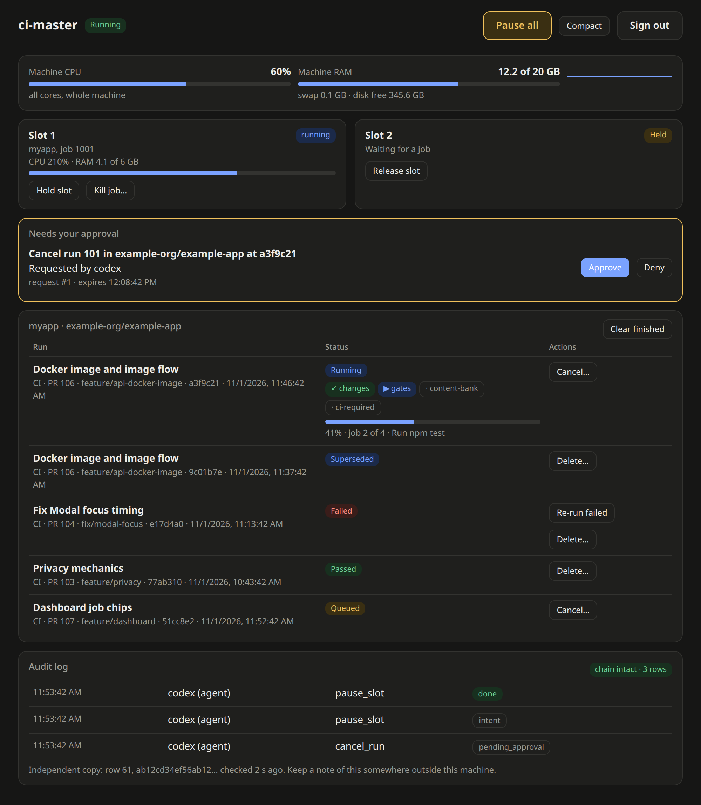
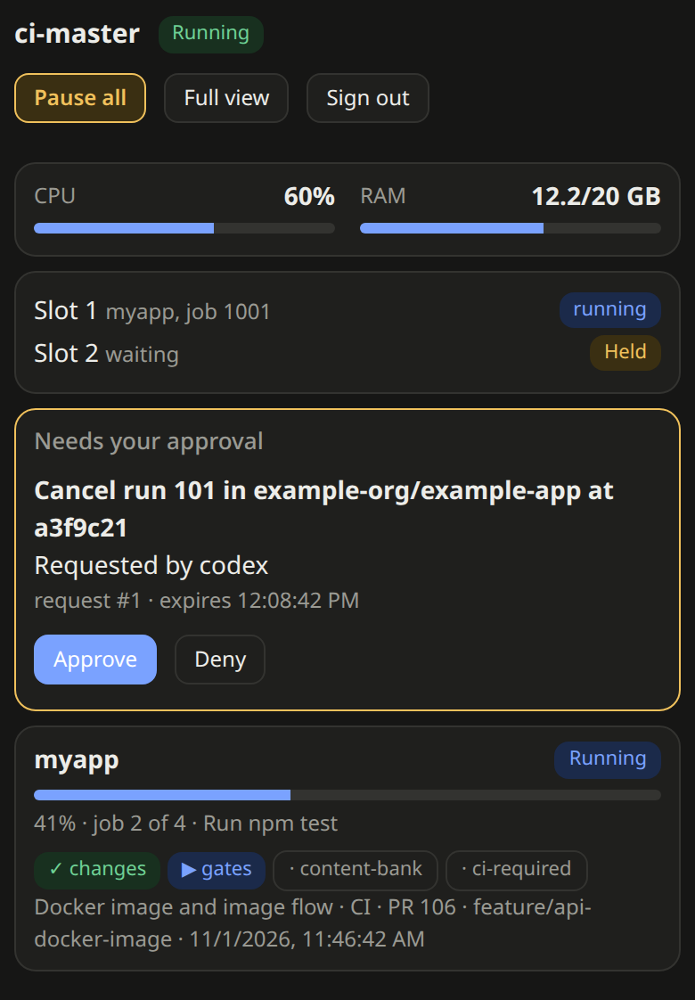

# ci-master

A self-hosted GitHub Actions CI farm for one Ubuntu machine. Every job runs in a disposable, rootless-Docker slot with its own one-time runner credential. A local dashboard and one tool for AI agents control it, and every action they take is audited.

Private repositories only. No secrets in this repo or in images, and among credentials supplied by ci-master the GitHub App key never reaches a job container: a job gets only its own one-time runner credential and GitHub's job-scoped token, while any secrets a workflow itself requests are delivered into that job by GitHub, so deploy and migration lanes that hold real secrets stay on GitHub-hosted runners.

Status: in real use since 31 October 2026. The installer was run in a clean Ubuntu Server 26.04 VM with a fake GitHub App (dry run, real install through the self-check where only the GitHub App check failed as expected, the failure rollback, and the uninstall all worked); not yet tested: a live GitHub App, a real job, and other distributions (see [Status](#status)). Licensed under [Apache-2.0](LICENSE). Security policy and known limits: [SECURITY.md](SECURITY.md).

⭐ Staraware. If this saves you time, star the repo.

## What it looks like

The dashboard (sample data from the built-in preview, not a real run):



The same view on a phone, in the compact layout:



## What it does

- **Runs CI on your own machine instead of GitHub-hosted minutes.** Pull request CI for a full-stack project (lint, tests, build, a real PostgreSQL, browser UI regression, a Docker image smoke test) takes about 15 to 20 minutes and uses none of the monthly free minutes.
- **One disposable slot per job.** A poller watches for queued jobs, reserves a slot, mints a just-in-time runner credential through a GitHub App, runs the job in a throw-away rootless Docker environment, and tears everything down afterwards.
- **Locked-down network.** Slots sit behind an egress filter (nft) that blocks private and local ranges.
- **Several projects, several isolation groups.** A registry (`config/registry.example.yaml`) lists each repository with its own runner label, resource caps, allowed events and lanes. A push-triggered lane can be limited to named branches.
- **Deploy lanes stay on GitHub.** Anything that holds real secrets (database migrations, deploy hooks) is never scheduled on the farm. Builds that need no secrets, such as building and pushing a container image with the job's own token, can run on it.
- **A dashboard** with machine CPU and RAM, per-slot usage, run history with PR titles and branches, per-job chips (`changes`, `gates`, `content-bank`, ...), a progress bar with the current step, approvals, and the audit log. "Clear finished" hides finished runs in your browser only; nothing is deleted on GitHub.
- **One tool for AI agents** (an MCP server plus a CLI), used by Claude Code, Codex and Gemini. Agents can read status and runs, and can do reversible things such as pausing a slot or re-running failed jobs within limits. Whether dangerous actions (cancel a run, re-run all jobs, delete a run, kill a job) need human approval in the dashboard with a second factor depends on the agent's permission preset: **Cautious** (the default) asks for approval, while **Trusted** (or `Allow` cells) lets agents cancel, delete and re-run without asking (`kill_slot` and `restart_slot` still ask by default). There is deliberately no tool to approve, to edit permissions or to read the GitHub App key.
- **A tamper-evident audit log.** Every action except routine successful reads (`status`, `runs`, `resources`; `audit_read` is logged at most once per actor per 5 minutes), including denials, is recorded in a hash chain, and an independent receiver keeps a second copy.
- **A watchdog** restarts a down or stuck service, and agents can request a restart without a password.

The services: `ci-controld` (poller, control API and dashboard), `ci-broker` (rootless Docker slots), `ci-auditd` (independent audit copy), `ci-egress` (network filter) and `ci-watchdog`.

## What we achieved so far

- Design, an isolation spike and several independent security reviews (findings fixed or explicitly accepted in the design plan).
- A working core: registry, poller, JIT runner minting, slot lifecycle, resource caps, and a state database that is reconciled after a restart.
- The control layer: dashboard, per-agent permissions, human approvals with a second factor, the audit chain and its independent receiver, and the watchdog.
- Multi-project support with isolation groups, and a push-branch guard for lanes that react to pushes.
- Real use: a full-stack project runs its pull request CI on the farm, switched on and off by one repository variable. Its API container image is built, smoke-tested and pushed to a private registry on the farm, then deployed by digest.
- Dashboard improvements: progress bar with the current step, run titles and branches, job chips, clear finished.
- Over 160 automated tests, and an independent open-source readiness review with every finding handled (see the security review above).

## Install

You run the installer yourself, in your own terminal, on the machine that will host the farm. Do not ask an agent to run it: it needs root and prints a secret that is shown only once. Agents come in afterwards, through the limited tools in [docs/AGENT-TOOLS.md](docs/AGENT-TOOLS.md).

**You need:**
- Ubuntu 24.04 or newer on x86_64 with at least 4 CPUs, 8 GiB RAM and 30 GiB free under /var/lib (a 60 GB disk is comfortable).
- One **private** GitHub repository you want CI for.
- A GitHub App installed on that repository, with its App ID, its installation ID and the downloaded `.pem` key file. Expected repository permissions, read from the code and not yet confirmed against a live install: Actions (read and write), Administration (read and write, for runner registration) and Metadata (read). The installer's final check, scripts/check-app.ts, prints the App's actual permissions.

**Steps:**

```bash
git clone https://github.com/silverhawk-tech/ci-farm && cd ci-farm
COMMIT=$(git rev-parse HEAD)
git show $COMMIT:scripts/install-farm.sh | less    # read it first
git show $COMMIT:scripts/install-farm.sh | CI_SRC=$PWD COMMIT=$COMMIT bash -s -- --dry-run    # no root, changes nothing
git show $COMMIT:scripts/install-farm.sh | sudo CI_SRC=$PWD COMMIT=$COMMIT bash    # the real install
```

The real run asks for the repository (`owner/name`), the App ID, the installation ID and the key's file path, then waits for you to type `install`. At the end it prints your second-factor secret and dashboard token once; save them then. To remove everything, run the same command with `--uninstall` (add `--purge` to delete data too).

## Status

This project is experimental. The installer was reviewed by a second AI provider, passes its unit tests and ShellCheck, and was run in a clean Ubuntu Server 26.04 VM with a fake GitHub App (dry run, real install through the self-check where only the GitHub App check failed as expected, the failure rollback, and the uninstall all worked). Not yet tested: a live GitHub App, a real job, and other distributions. Start with `--dry-run`, and open an issue if anything fails. Before a real run, compare the pinned Node checksum in `scripts/install-farm.sh` with the one published at nodejs.org.

## Built with agents

This project is built with AI agents. A manager session splits the work, and implementer sessions (Claude Code, with Codex for some fixes) write each change as a pull request, and a different provider than the author reviews it. A second AI provider reviews the changes independently (Codex, and Gemini on some review rounds). Unit tests and ShellCheck are run on the changes before review. The tool that lets the agents call each other's providers is [ai-delegator](https://github.com/silverhawk-tech/ai-delegator).

## Related tools

- [ai-delegator](https://github.com/silverhawk-tech/ai-delegator): a local MCP server that lets Codex, Claude Code and Antigravity CLI delegate work to one another while the user keeps control of the provider, model and reasoning level.

## Documents

- Design and decisions: [docs/DESIGN-PLAN.md](docs/DESIGN-PLAN.md)
- Installer 1 (design note): [docs/INSTALLER-DESIGN.md](docs/INSTALLER-DESIGN.md)
- Agent tools: [docs/AGENT-TOOLS.md](docs/AGENT-TOOLS.md)
- Security: [SECURITY.md](SECURITY.md) and the latest review, [docs/SECURITY-REVIEW-2026-11-01.md](docs/SECURITY-REVIEW-2026-11-01.md)
- Rules for agents working here: [AGENTS.md](AGENTS.md)
- Attributions: [NOTICE](NOTICE)

## Development

```bash
npm test
```

The dashboard can be previewed with sample data using `npx tsx scripts/dev-dashboard.ts` (it listens on 127.0.0.1:8788 and prints a throw-away token).
